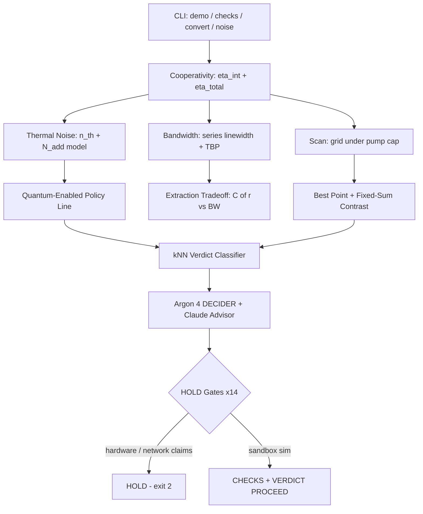
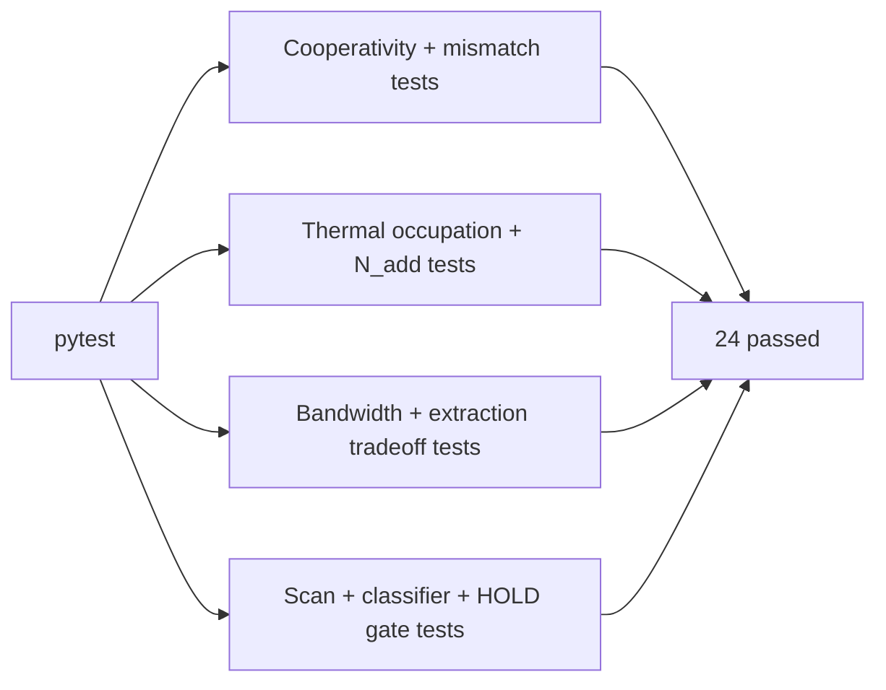
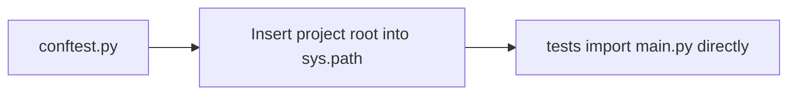
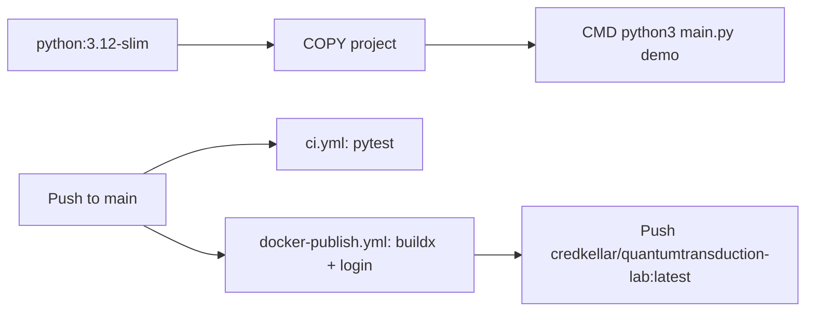

# QuantumTransduction-Lab 🔄⚛️

**Microwave-to-Optical Quantum Transduction Lab** — by Darion Kellar

QuantumTransduction-Lab is an **educational quantum transduction lab** in ONE pure-Python file. A quantum transducer is the missing adapter of quantum hardware: superconducting qubits speak **microwave** (here, a labelled 5 GHz mode), optical fiber speaks **light** (here, a labelled ~1550 nm mode), and a transducer is supposed to convert one into the other without destroying the quantum state. This lab evaluates the **standard textbook formulas** that decide whether such a converter can work at all:

- **Conversion efficiency** from the beam-splitter cooperativity formula `eta_int = 4·C1·C2 / (1 + C1 + C2)²` — near unity only when the electromechanical cooperativity C1 and the optomechanical cooperativity C2 are **both large and matched** 🔄
- **Thermal noise** from the Bose–Einstein occupation `n_th = 1/(exp(hf/kT) − 1)` at exact SI constants — a 5 GHz mode at 4 K holds **16.17 thermal photons**, and the lab's labelled added-noise bookkeeping (`N_add = n_th / C_harm`) decides which operating points are actually **quantum-enabled** 🌡️
- **Bandwidth and extraction bookkeeping** — a series-linewidth conversion bandwidth, a time–bandwidth product for a labelled pulse, and the efficiency–bandwidth tradeoff that peaks at an interior extraction ratio 📈
- **An operating-point scan** over (C1, C2) under a labelled pump cap, and a from-scratch kNN verdict classifier whose labels come from the lab's own policy 🏷️

Honest scope, stated up front: every parameter is a **labelled teaching value, not a device specification** — no transducer was built, cooled, pumped, or measured. An efficiency here is a statement about a formula at stated inputs, never a hardware promise. Every hardware / network / vendor claim sits behind a permanent HOLD gate (14 total). 🔒

[](https://github.com/kimanicollier44-cmyk/QuantumTransduction-Lab/actions/workflows/ci.yml)
[](https://github.com/kimanicollier44-cmyk/QuantumTransduction-Lab/actions/workflows/docker-publish.yml)

> ℹ️ These are the **live** workflow badges for this repo. They activate as soon as the `ci.yml` and `docker-publish.yml` files from the paste pack are pasted into `.github/workflows/` — until then they have nothing to report yet.

## 🧰 Tech Stack Badges & Full Architecture Tech Stack

### 💻 Core Programming Languages & Core Systems


- 🐍 Python 3.12, pure standard library (`math`, `hashlib`, `json`, `sys`) — zero dependencies, zero network, deterministic (double-run byte-identical)
- 🔄 Transduction physics core: the beam-splitter cooperativity efficiency `4·C1·C2/(1 + C1 + C2)²`, Bose–Einstein thermal occupation from exact SI constants (h, k_B), a labelled added-noise model `N_add = n_th / C_harm`, series-linewidth bandwidth, and the extraction tradeoff `C(r) = C0·(1 − r)` — every headline number asserted against its analytic value in CHECKS
- 🗺️ Operating-point scan: an 11×11 (C1, C2) grid swept under a labelled pump cap (C1 + C2 ≤ 200), reporting its own optimum and a fixed-sum matched-vs-lopsided contrast
- 🧠 TinyML kNN verdict classifier (from scratch, stdlib): quantum-enabled / efficient-but-noisy / quiet-but-lossy / unusable from (eta, N_add)
- 🪑 Council seats: Gemini Argon 4 DECIDER (names-only, tighten-only) + Muse advisor (never overrides HOLD) + Google Flow plan-only (rendered = False, live = 0)

### ⛓️ Web3 & Infrastructure

- 🚫 **Not applicable — honestly.** No blockchain, no Web3, no tokens: the "infrastructure" in this lab is a labelled evaluation of converter formulas inside one offline file. Quantum-network deployment is a permanent HOLD gate, not a feature. No fake badges here.

### ⚙️ Platform Support & Hardware Architecture


- 🖥️ Pure Python — runs anywhere Python 3.12+ runs (Linux, macOS, Windows), plus the `python:3.12-slim` Docker image
- 🔒 No hardware is controlled, ever: real transducers, cryostats, lasers, and microwave sources are permanent HOLD gates (see the gate table below)

### ⚡ Low-Level Infrastructure & Performance

- 🚫 **No low-level code — honestly.** No C, no C++, no GPU, no compiled extensions: this is one interpreted Python file on purpose, so every number can be read, checked, and diffed. Performance here means honest algorithms — closed-form efficiency and occupation formulas, an exhaustive grid scan under the cap, and a kNN over a policy-labelled grid — all deterministic and byte-identical between runs.

### 🛠️ DevOps & Build Tools


- 🐳 Docker (`python:3.12-slim`), GitHub Actions CI + Docker Publish (delivered in the paste pack)
- 🎯 Target image: `credkellar/quantumtransduction-lab:latest`
- 🧪 Tests: `pytest` (24 tests) + the built-in CHECKS suite (50 checks) in `main.py`

### ☁️ Cloud Providers

- 🚫 **None — honestly.** No cloud provider is used or needed: the lab runs fully offline on your own machine or in a local Docker container. Docker Hub appears only as the registry the publish workflow pushes the image to.

## What this does?

1. 🔄 **Cooperativity conversion — the unity condition** — internal efficiency `eta_int = 4·C1·C2/(1 + C1 + C2)²` computed at matched points: C = 1 → **0.444444**, C = 10 → **0.907029**, C = 100 → **0.990075**. With the labelled 0.90 extraction ratios on both ports, total efficiency is **0.360000 / 0.734694 / 0.801960**. Unity is a limit, approached only as C1 = C2 → ∞ — the formula says so, and the lab prints it that way.
2. 🪨 **The mismatch cliff** — hold one side at C1 = 100 and starve the other: C2 = 1 gives eta_int = **0.038447**, a 26× collapse from the matched point. At a fixed budget C1 + C2 = 200 the contrast is priced three ways: matched 100/100 → **0.990075**, lopsided 150/50 → **0.742556**, extreme 199/1 → **0.019702**. Cooperativity you cannot match is cooperativity you do not have.
3. 🌡️ **Thermal occupation — why the fridge is not optional** — at 5 GHz, hf/k = **0.239962 K** (exact SI constants). The Bose–Einstein occupation is **16.174294** photons at 4 K, **0.099810** at 100 mK, and **3.79 × 10⁻¹¹** at 10 mK. A room-temperature-adjacent bench is a hot bath screaming into the microwave port; the optical port at 193.4 THz is thermally empty by the same formula — that asymmetry is the whole reason transducers live in dilution refrigerators.
4. 🔊 **Added noise + the quantum-enabled line** — the labelled model `N_add = n_th / C_harm` (harmonic-mean cooperativity) refers the bath to the input: at matched C = 10, N_add = **1.61743** at 4 K, **0.009981** at 100 mK, **3.79 × 10⁻¹²** at 10 mK. The lab's policy line is explicit — quantum-enabled needs eta_total ≥ 0.5 **and** N_add < 1 — so the identical converter is efficient-but-noisy on the bench and quantum-enabled in the fridge. Both verdicts are computed, not asserted.
5. 📶 **Bandwidth + pulse bookkeeping** — labelled loaded linewidths (microwave 10 MHz, optical 20 MHz) combine in series to a conversion bandwidth of **6.6667 MHz**; a labelled 150 ns pulse gives a time–bandwidth product of exactly **1.0000**. The narrower port sets the speed — printed as the labelled model it is.
6. ⚖️ **The extraction tradeoff** — with C(r) = 1000·(1 − r) per side, total efficiency climbs 0.249501 (r = 0.5) → 0.801960 (r = 0.9) → **0.888980 at r = 0.99** — then collapses to 0.443556 at r = 0.999, because the cooperativity has been extracted away. Bandwidth grows the whole time (2 → 10 → 100 → 1000 MHz): past the peak you are buying bandwidth with efficiency at a ruinous rate, and the table shows the exchange rate.
7. 🗺️ **Operating-point scan under a pump cap** — an 11×11 grid over (C1, C2) with the labelled cap C1 + C2 ≤ 200 evaluates **81 points** and finds its own best: **C1 = C2 = 100**, eta_int **0.990075**, eta_total **0.801960**. The matched optimum is discovered by the sweep, not assumed by the author.
8. 🏷️ **Verdict classifier + seats + checks** — a from-scratch kNN labels operating points quantum-enabled / efficient-but-noisy / quiet-but-lossy / unusable (matched C = 10 at 100 mK: quantum-enabled; the same point at 4 K: efficient-but-noisy; C = 1 cold: quiet-but-lossy; C = 0.1 hot: unusable), with Argon 4 DECIDER (sha256 trace), Muse advisor, Google Flow plan-only, and a built-in CHECKS suite (50 checks).

## 🗺️ How it works — diagram per script

### `main.py` — the whole lab



### `tests/test_main.py` — verification



### `conftest.py` — test path setup



### `Dockerfile` + CI flow — container & publish



## Why is this cool?

1. 🎯 The unity condition is **derived, not marketed**: `4·C1·C2/(1 + C1 + C2)²` reaches 0.990075 only at matched C = 100 — and the lab shows the limit is a limit, never a product claim.
2. 🪨 The mismatch cliff is priced to the digit: one starved side (100 vs 1) costs 26× of your efficiency — 0.990075 → 0.038447 — the single most under-taught fact in transducer talks.
3. 🌡️ One formula explains the entire cryogenics budget: hf/k = 0.239962 K at 5 GHz means 4 K is a 16-photon firehose and 100 mK is quiet — the fridge is in the math before it is in the lab.
4. 🔊 "Quantum-enabled" is a **checked policy line**, not a vibe: eta ≥ 0.5 and N_add < 1, evaluated per operating point, with the 4 K point failing on noise while passing on efficiency.
5. ⚖️ The extraction tradeoff has a real interior peak (r = 0.99, eta_total 0.888980) and a real collapse past it — bandwidth and efficiency trading at a printed exchange rate.
6. 🗺️ The scan finds the matched optimum itself: 81 grid points under a pump cap, best point reported with its cap arithmetic in the open.
7. 🧮 Exact SI constants, no fitted anything: h and k_B are the exact 2019 SI values, and the high-temperature limit of n_th is checked against kT/hf − ½.
8. 🏷️ The kNN classifier's labels come from the lab's own policy over its own computed points — it interpolates the verdict rule, it does not invent one.
9. 🔒 The honesty is structural: 14 named HOLD gates (hardware efficiency, quantum network, measurement fabrication, guaranteed fidelity…) return exit code 2, forever.
10. 🎯 Deterministic end to end: run it twice, get byte-identical output — a transducer you can diff.

## What problems this solves?

1. ❌ **Problem:** Transducer explainers quote peak efficiencies without the matching condition. ✅ **Solution:** Every efficiency is printed next to its (C1, C2) pair, and the mismatch cliff (0.038447 at 100/1) is a first-class output.
2. ❌ **Problem:** "High efficiency" gets conflated with "quantum-ready". ✅ **Solution:** Efficiency and noise are separate axes with a separate verdict — the 4 K point is efficient-but-noisy, and the classifier says so.
3. ❌ **Problem:** Thermal noise is hand-waved as "needs to be cold". ✅ **Solution:** n_th is computed from exact SI constants at 4 K / 100 mK / 10 mK — 16.174294 vs 0.099810 vs 3.79 × 10⁻¹¹ — so "cold" has a number.
4. ❌ **Problem:** Added-noise figures appear without a stated model. ✅ **Solution:** The model is one labelled line — `N_add = n_th / C_harm` — named wherever it is used, never dressed up as a measurement.
5. ❌ **Problem:** Extraction is presented as a free lunch (wider port, more signal). ✅ **Solution:** The tradeoff table shows the interior peak at r = 0.99 and the collapse at r = 0.999 where the cooperativity is extracted away.
6. ❌ **Problem:** Bandwidth claims ignore which port is narrow. ✅ **Solution:** The series-linewidth model makes the narrower port dominate — 10 MHz and 20 MHz combine to 6.6667 MHz, not 15.
7. ❌ **Problem:** "Optimal operating point" usually means the author's favorite point. ✅ **Solution:** The scan sweeps the grid under a stated pump cap and reports the count (81), the cap, and the winner it actually found.
8. ❌ **Problem:** Fixed-budget comparisons hide the allocation question. ✅ **Solution:** The fixed-sum contrast (100/100 vs 150/50 vs 199/1 at sum 200) isolates allocation from budget: matching is worth 50× over the extreme split.
9. ❌ **Problem:** Simulation tools quietly imply a device or a network is next. ✅ **Solution:** `hardware_efficiency_claim`, `quantum_network_deployment`, and `measurement_fabrication` are permanent HOLD gates — computed values may never be presented as measurements.
10. ❌ **Problem:** Efficiency gets sold as fidelity. ✅ **Solution:** The lab never computes a fidelity and gates `guaranteed_fidelity_claim` explicitly — eta is a photon-number ratio, not a state-transfer promise.

## How to install this?

1. 📋 Clone or download this project folder.
2. 🐍 Make sure Python 3.12+ is installed: `python3 --version`
3. ▶️ Run the full demo + checks (no arguments needed):

```bash
python3 main.py
```

4. 🧪 Run the test suite:

```bash
pip install pytest
python3 -m pytest -q
```

5. 🎛️ Try the other commands:

```bash
python3 main.py checks    # 50 built-in checks
python3 main.py convert   # cooperativity conversion report (JSON)
python3 main.py noise     # thermal occupation + added noise report (JSON)
python3 main.py bandwidth # bandwidth, TBP + extraction tradeoff (JSON)
python3 main.py scan      # operating-point scan under the pump cap (JSON)
python3 main.py classify  # kNN verdict classifier report
python3 main.py brains    # Argon 4 + Muse + Flow seats
python3 main.py holds     # list all 14 HOLD gates
python3 main.py hold-demo # exits 2 - gated actions stay HOLD
```

6. 🐳 Or run it in Docker:

```bash
docker build -t credkellar/quantumtransduction-lab:latest .
docker run --rm credkellar/quantumtransduction-lab:latest
```

## Requirements

- 🐍 Python 3.12 or newer
- 📦 Dependencies: **none** (standard library only)
- 🌐 Network: **none** — fully offline
- 🧪 For tests only: `pytest`
- 🐳 Optional: Docker

## FULL project structure tree

```text
quantumtransduction-lab/
├── main.py                  # the whole lab: cooperativity conversion, thermal noise, bandwidth, extraction tradeoff, scan, classifier, seats, HOLD gates
├── conftest.py              # puts the project root on sys.path for tests
├── tests/
│   └── test_main.py         # 24 pytest tests: conversion, noise, bandwidth, scan, classifier, gates, determinism
├── assets/
│   └── cover.png            # README cover image (2736 x 912)
├── Dockerfile               # python:3.12-slim, runs the demo
├── .gitignore               # __pycache__/, .pytest_cache/, *.pyc
└── README.md                # this file
```

> 📦 Delivered separately as paste packs (not in this tree): `.github/workflows/ci.yml` + `docker-publish.yml`, and the Docker Hub pack (100-char description, 350-char About, overview, categories).

## 🔒 HOLD gates — all 14, permanent

| # | Gate | What stays held |
|---|------|-----------------|
| 1 | `hardware_efficiency_claim` | No claiming a real device achieves these efficiencies; the numbers are formula evaluations at labelled inputs |
| 2 | `device_specification_claim` | No presenting labelled teaching parameters as a real device specification |
| 3 | `quantum_network_deployment` | No deploying or operating a real quantum network link from a formula lab |
| 4 | `entanglement_distribution_claim` | No claiming entanglement was generated, distributed, or verified |
| 5 | `cryogenic_operation_live` | No directing live cryogenic, microwave, or vacuum hardware |
| 6 | `laser_operation_live` | No directing live lasers, optical pumps, or high-power optics |
| 7 | `vendor_performance_claim` | No vendor or product performance claims from textbook formulas |
| 8 | `quantum_internet_claim` | No "quantum internet ready" claims; a cooperativity table is not infrastructure |
| 9 | `qkd_security_claim` | No claiming QKD-grade or cryptographic security from an efficiency formula |
| 10 | `medical_claim` | No medical imaging, sensing, or diagnostic claims |
| 11 | `investment_claim` | No investment claims; a lab model is not a prospectus |
| 12 | `telecom_infrastructure_claim` | No claiming telecom infrastructure readiness or carrier deployment |
| 13 | `measurement_fabrication` | No presenting computed values as measurements; nothing here was measured |
| 14 | `guaranteed_fidelity_claim` | No guaranteed state-transfer fidelity; efficiency is not fidelity and neither is promised |

🧑‍⚖️ **Council seats:** Gemini Argon 4 Extended Thinking — DECIDER (names-only, tighten-only, MAP → MODEL → STRESS → DECIDE, sha256 trace, `can_override_hold = False`) · Muse — advisor (`can_override_hold = False`) · Google Flow — plan-only (`rendered = False`, `live = 0`).

✅ **Verification:** pytest **24 passed** (project + clean copy) · built-in CHECKS **50/50** · double-run output **byte-identical** · `hold-demo` exits **2** · `main.py` **679 lines**, pure stdlib, zero network.

## 🧒 5th-grade English section

Imagine two friends who speak completely different languages. One speaks in **microwave** — slow, deep waves, like a tuba. The other speaks in **light** — super fast tiny waves, like a whistle only lasers can hear. A **transducer** is a translator box that listens to the tuba and repeats the message on the whistle. 🎺💡

- For the translator to hear both sides well, **both ears have to be equally strong**. Scientists measure ear strength with a number called cooperativity. If one ear is super strong (100) and the other is weak (1), the translator misses almost everything — this lab does the math and shows the message dropping from 99% heard to under 4%. 👂
- Microwaves also have a noise problem: **warm things buzz**. At regular fridge temperature, the microwave side hears about 16 buzzing noise photons for every real message photon — like trying to hear a whisper at a rock concert. Cool everything down to a hundred times colder than a fridge, and the buzz nearly disappears. ❄️
- There is also a door problem. A wider door lets messages out faster (more bandwidth!), but if you make the door too wide, the translator's ears get weak and it stops hearing well. The lab finds the **just-right door width** — and shows the exact spot where wider stops being better. 🚪
- This project is a **pretend lab on a computer**. It does not build a real translator or connect any real quantum computers. It helps you learn why translating between microwaves and light is one of the hardest — and coolest — puzzles in quantum science. 💻

---

MIT © 2026 Darion Kellar · QuantumTransduction-Lab — educational simulation only 🔄
